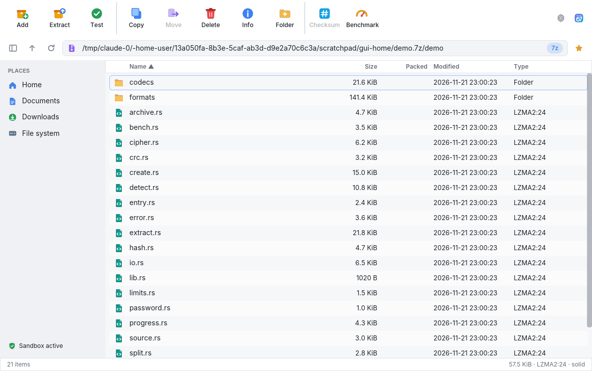
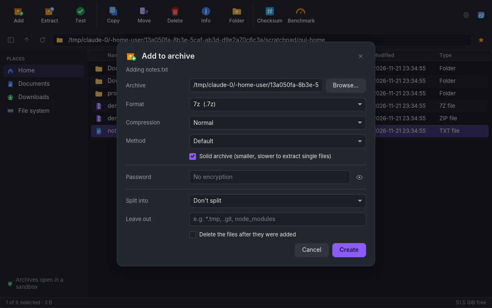

# 67zip

A fast, secure archive manager for Linux, in the spirit of 7-Zip, with a
modern interface that looks the same on every distribution.



- **Own archive engine in safe Rust.** The 7z, zip, tar and RAR formats,
  gzip framing, the multi-core bzip2 decoder, the RAR decompressors, safe
  extraction and the sandbox are written for 67zip. `unsafe`
  code is forbidden in every 67zip crate. Compression algorithms and
  encryption come from small, widely used pure-Rust libraries; encryption
  is never home-made.
- **Sandboxed.** Archives are opened in a separate worker process that locks
  itself down with Landlock (it can reach only the files of the current
  operation) and seccomp (no network, cannot start programs). The window
  you see never parses archive data.
- **About as fast as 7-Zip.** Multi-threaded LZMA2, measured against 7-Zip
  23.01 on the same machine. See [Speed](#speed).
- **Looks right everywhere.** Its own icon set and bundled Inter font.
  Light and dark themes follow your desktop, including its accent colour.

## Formats

| Format | Open / extract | Create / change | Notes |
|---|---|---|---|
| 7z | yes | yes | LZMA2 (multi-threaded), LZMA, PPMd, BZip2, Deflate, Copy; BCJ, BCJ2, ARM64, Delta filters; AES-256, encrypted file names |
| zip | yes | yes | Deflate, BZip2, LZMA, XZ, Zstd, Store, PPMd (read); Zip64; UTF-8 names; AES-256 (read and write); old ZipCrypto (read only) |
| tar | yes | yes | ustar, PAX, GNU long names; plain or with gz, bz2, xz, zst, lz, lzma |
| gz, bz2, xz, zst, lzma, lz | yes | yes | single files |
| Split archives | yes | yes | open from any part: `.001`, `.part1.7z` / `.part01.rar`-style names, `.7z.part1`, PKZIP `.z01` … `.zip`, RAR `.rar` + `.r00` …, `split`'s `.aa`; create `.001` parts with "Split into" or `-v100m` |
| iso | yes | no | ISO 9660 with Rock Ridge (permissions, links) and Joliet (Unicode names) |
| rar | yes | no | RAR5 and RAR 2.0–4.x: solid, multi-volume (`.part1.rar` or `.rar` + `.r00`), self-extracting `.exe`/`.sfx`, AES-256 / AES-128 including encrypted file names, BLAKE2sp checksums, links, comments, file versions. Not supported: RAR 1.5 compression and RAR 2.0 encryption (1990s archives) |

## Install

Building needs [Rust](https://rustup.rs) 1.88 or newer.

```sh
git clone https://github.com/gamesensicals/67zip
cd 67zip
./install.sh                  # builds and installs for your user into ~/.local
sudo ./install.sh --system    # or for everyone into /usr/local, after building
                              # as your user (root never compiles anything)
```

The script installs:
- `67zip` (the app) and `67z` (the command line tool);
- a menu entry, the icon, and "Open with" for archive files;
- "Extract here" and "Add to archive" menus for Dolphin, Nemo and Nautilus.

Remove everything with `./install.sh --uninstall`.

Packaging files are included for a `.deb` (`cargo deb -p zip67-gui`), for
Flatpak (`packaging/flatpak/`) and for an AppImage
(`packaging/appimage/build.sh`, which downloads `appimagetool`; build it on
an older distro so it runs on more systems).

On distributions without a desktop, the app needs `libxkbcommon-x11` (or
Wayland) and working OpenGL or Vulkan drivers, as any desktop provides.

## Using the app



- **Moving around:** double-click a folder or archive to open it. Backspace
  goes up a level. An archive opens like a folder, and so does an archive
  inside an archive. Changes to an inner archive are saved back into the
  outer one. Opening a file inside it
  starts your usual app for that file. If you change and save the file,
  67zip offers to put the new version back into the archive.
- **Toolbar:** Add, Extract, Test, Copy, Move, Delete, Info, New folder,
  Checksum, Benchmark.
- **Right-click** for Extract here, Extract to "name/", Add to "name.7z",
  and more.
- **Drag files onto the window.** In a folder, this opens or compresses
  them; inside an archive, it adds them.
- **Keys:**
  - Enter opens; Alt+Enter shows properties.
  - F2 renames, F5 copies, F6 moves, F7 creates a folder.
  - Del deletes; Ctrl+A selects all.
  - Ctrl+H shows hidden files; Ctrl+L jumps to the address bar.
  - F9 toggles the sidebar.
- **Deleting** on disk moves items to the desktop Trash, which you can turn
  off in Settings.

## Command line: `67z`

`67z` follows 7-Zip's `7z` syntax:

```sh
67z a photos.7z ~/Pictures            # create or add (7z by default)
67z a -tzip -p backup.zip docs/       # zip with AES-256, asks for the password
67z a -mx9 -mhe=on -psecret x.7z dir  # ultra, encrypted file names
67z a -p -sshred vault.7z private/    # encrypt, then securely delete the originals
67z a -ttar.zst code.tar.zst src/
67z l archive.7z                      # list (-slt for details)
67z t archive.zip                     # test
67z x archive.7z -o/tmp/out           # extract with folders
67z e archive.7z -o/tmp/flat          # extract without folders
67z d archive.7z old/file.txt         # delete inside an archive
67z rn archive.7z a.txt b.txt         # rename inside an archive
67z h -scrcSHA256 file.iso            # checksums (CRC32, CRC64, SHA-1/256/512, BLAKE3, MD5)
67z b                                 # benchmark
```

Run `67z --help` for all switches. Exit codes match 7-Zip: 0 means OK,
1 a warning, 2 an error, 7 a bad command line, and 255 that you stopped it.

## Security

What a malicious archive cannot do in 67zip:

- **Write outside the destination folder.** `../` paths and absolute paths
  are refused. All writes go through a directory handle
  ([cap-std](https://github.com/bytecodealliance/cap-std)) that resolves
  paths only beneath the destination, so even symlink races cannot redirect
  them.
- **Plant escaping links.** Symlinks whose target would leave the
  destination are not created. Device files, FIFOs and setuid/setgid bits
  are never created.
- **Exhaust disk or memory.** Decompression-bomb limits cover total size,
  expansion ratio, dictionary and model memory, header size and entry
  count. Overlapping zip entries (the "non-recursive zip bomb") are
  rejected.
- **Pass tampered data off as fine.** Every CRC is checked. Zip AES data is
  checked with its HMAC before extraction counts as successful. Partly
  written files are removed when a check fails.
- **Disguise a file name.** Control characters and invisible text-direction
  characters are shown as `\u{…}` codes and flagged, because names like
  `invoice\u{202e}fdp.exe` are used to fake file types.
- **Run code.** RAR 2.9 archives can carry filter programs for a virtual
  machine. 67zip never executes them: it recognises WinRAR's six standard
  filters by checksum and runs its own implementation of each.
- **Escape the worker.** Archive parsing runs in a separate process (for
  the app and for `67z` alike) restricted by Landlock and seccomp: it can
  read only the archive and write only where the operation writes, has no
  network, cannot start programs, cannot signal, debug or take file
  descriptors from other processes, cannot create namespaces, and cannot
  type into a terminal (`TIOCSTI`). It has no terminal at all. A new or
  changed archive is written into a private staging folder; the
  unsandboxed side checks the result and moves it into place, so even a
  compromised worker cannot touch the rest of that folder. Try
  `67z --sandbox-selftest /tmp/somedir` to see the checks pass on your
  kernel (Landlock needs Linux 5.13 or newer).
- **Mess with your terminal or dialogs.** Names and messages from
  archives are shown with control and text-direction characters escaped.
- **Leave world-writable files.** Permissions from archives are limited by
  your umask; setuid/setgid bits are dropped.
- **Run a launcher.** Files opened from inside an archive lose their
  execute permission, and `.desktop` launchers are not opened.

Optional secure deletion:

- **Delete originals securely** after archiving them ("Securely" under
  "Delete the files after they were added", or `67z a -sshred`): each file
  is overwritten with random data and flushed to the disk, renamed to a
  random name, then deleted. Files with other hard links are kept (their
  data would survive under the other name).
- **Decrypted temporary copies** of files you open from inside an archive
  are overwritten and deleted when 67zip closes (or, after a crash, when
  it next starts). They normally live in memory (`$XDG_RUNTIME_DIR`);
  67zip warns when they have to go to a disk.
- Overwriting reliably destroys old data only on hard disks with ordinary
  file systems (ext4, XFS). SSDs move data between their cells, and
  copy-on-write file systems (btrfs, ZFS, bcachefs, f2fs), snapshots and
  backups keep old copies; 67zip warns in those cases. Full-disk
  encryption (LUKS) is what protects data on them.

Other protections:

- Passwords are wiped from memory after use and are never stored.
- Archives are changed by writing a new temporary file and renaming it
  over the original in one step, so a failure never leaves half an archive.
- Release builds check every integer operation for overflow.
- `fuzz/` holds fuzz targets for every parser, run in CI.

Good to know:

- Extracting writes into the folder you choose, so the worker may write
  anywhere inside it. Prefer "Extract to *name*/" over extracting straight
  into your home folder.
- `67z -pSECRET` puts the password on the command line, where other users
  of the computer can see it; use `-p` alone to be asked instead.
- Without Landlock (Linux older than 5.13, or disabled), the sandbox only
  blocks system calls; file access is not restricted.

Limits of the formats, not of 67zip:

- 7z encryption (AES-256-CBC) cannot detect deliberate modification of the
  encrypted data; zip AES can.
- Old ZipCrypto zip encryption is broken, so 67zip only reads it.

## Speed

These numbers were measured on a 4-core cloud VM against 7-Zip 23.01, with
the same threads and default level, on about 100–130 MB of text and
binaries. Above 100% means 67zip was faster. Repeat the check on your own
files with `tools/speedcheck.sh`. 67zip cannot create RAR files, so the
RAR5 numbers use archives written by the test encoder in
`crates/zip67-core/tests/rar5enc` (`cargo run --release --example
rar5enc`), which 7-Zip reads too.

| Task | 67zip vs 7-Zip |
|---|---|
| 7z compress (text, binaries) | 95–100% speed, files 0.7–2.3% larger |
| 7z extract (any 7z file) | about 100% |
| 7z extract (files made by 67zip) | about 170% |
| zip compress | 2–3× faster, files ~3% larger |
| zip extract | about 190% |
| bzip2 compress | about 200% |
| bzip2 extract | about 170% (own multi-core decoder) |
| RAR5 extract | 100–125% |
| RAR 2.9 extract | 100–400% on the available samples; PPMd text about 95% |

## Project layout

| Path | What it is |
|---|---|
| `crates/zip67-core` | the archive engine (formats, extraction, hashing) |
| `crates/zip67-worker` | the sandbox, the worker process and its protocol |
| `crates/zip67-cli` | the `67z` command line tool |
| `crates/zip67-gui` | the `67zip` app (built with [iced](https://iced.rs)) |
| `fuzz/` | fuzz targets (`cargo +nightly fuzz run sevenz`) |
| `data/`, `packaging/` | desktop integration and packages |

Run the tests with `cargo test --workspace`. Installing `7zip` makes the
compatibility tests run against real 7-Zip as well.

## License

67zip is licensed under the [MIT license](LICENSE). The bundled Inter font is
under the SIL Open Font License (`crates/zip67-gui/resources/fonts`). The
PPMd model used for RAR is vendored from
[ppmd-rust](https://github.com/hasenbanck/ppmd-rust) (CC0-1.0 or MIT-0), a
port of 7-Zip's public domain code. The RAR test archives come from the
test suites of libarchive (BSD 2-clause) and rarfile (ISC), see
`crates/zip67-core/tests/data/rar/README.md`.
